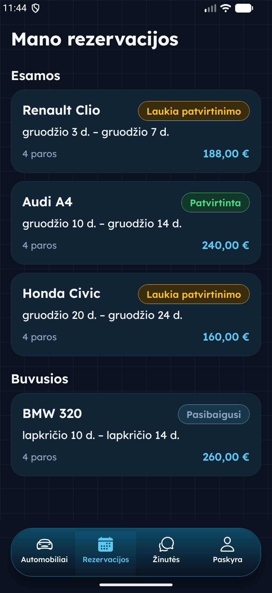
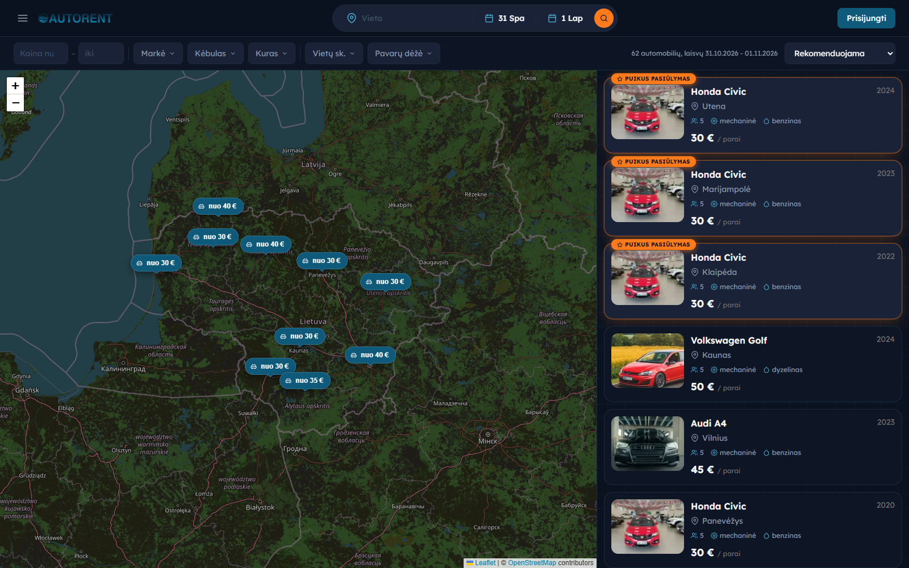
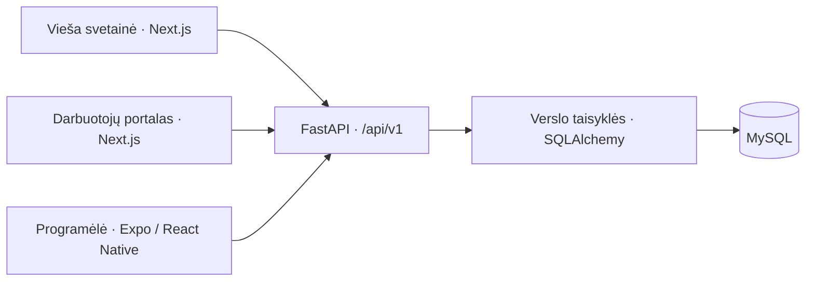

# AutoRent

Automobilių nuomos sistema su vieša svetaine, darbuotojų portalu ir mobiliąja programėle. Visos trys sąsajos naudoja bendrą FastAPI API ir MySQL duomenų bazę.

Svetainėje klientas gali ieškoti automobilio, sukurti rezervaciją ir naudotis lojalumo programa. Programėlėje įgyvendintas rezervavimas su užimtumo kalendoriumi, laikinu automobilio laikymu, papildomomis paslaugomis ir sąlygų priėmimu. Darbuotojų portalas skirtas nuomos, klientų, automobilių ir aptarnavimo valdymui.

## Ekrano vaizdai

### Mobilioji programėlė

| Katalogas | Automobilio informacija | Rezervavimo patvirtinimas |
|:---:|:---:|:---:|
|  |  |  |
| Rezervacijos | Rezervacijos eiga | Pagalbos pokalbis |
|  |  |  |

[Visi mobiliosios programėlės vaizdai](docs/ekrano_nuotraukos/mobile/). Nuotraukos užfiksuotos Android emuliatoriuje su atskirais demonstraciniais duomenimis.

### Svetainė ir darbuotojų portalas

| Viešas katalogas | Kliento paskyra |
|---|---|
|  |  |
| Darbuotojų informacinis skydelis | Rezervacijų valdymas |
|  |  |

[Daugiau svetainės ir portalo vaizdų](docs/ekrano_nuotraukos/).

## Sistemos dalys

| Dalis | Pagrindinės funkcijos |
|---|---|
| **Vieša svetainė** | Automobilių paieška, filtrai, žemėlapis, laisvumo tikrinimas, rezervacijos kūrimas, kliento profilis, lojalumo atlygiai ir pagalbos pokalbiai. |
| **Mobilioji programėlė** | Registracija ir prisijungimas, katalogas, paėmimo vieta, užimtumo kalendorius, paslaugos, kainos pasiūlymas, laikymas su laikmačiu, rezervacijos patvirtinimas, istorija, laiko juosta, atšaukimas ir žinutės. |
| **Darbuotojų portalas** | Automobiliai, klientai, darbuotojai, rezervacijų patvirtinimas, pavertimas užsakymu, nuomos būsenos, sąskaitų PDF, nuolaidų kodai ir pagalbos pokalbių tvarkymas. |
| **Backend** | Autentifikacija, vaidmenų teisės, užimtumo tikrinimas, rezervavimo taisyklės, kainos skaičiavimas, sąlygų versijos, pakartotinių patvirtinimų atpažinimas ir duomenų saugojimas. |

### Rezervavimas programėlėje

1. Klientas pasirenka automobilį ir laisvą 1–30 parų laikotarpį. Datos vertinamos pagal Vilniaus laiką.
2. Pasirenka paėmimo valandą nuo 12:00 iki 18:00 ir papildomas paslaugas. Grąžinimas numatytas iki 10:00 paskutinę dieną.
3. Serveris pateikia kainą pagal automobilio ir paslaugų tarifus. Pereinant į patvirtinimą automobilis laikomas 10 minučių.
4. Klientas priima nuomos sąlygas ir patvirtina rezervaciją. Užfiksuojami tarifai bei priimta sąlygų versija; idempotencijos raktas leidžia kartoti tą patį patvirtinimą nesukuriant antros rezervacijos.
5. Darbuotojas portale patvirtina rezervaciją. Klientas jos būseną ir eigą mato programėlėje.
6. Paverčiant rezervaciją užsakymu, suma apskaičiuojama iš užfiksuotų automobilio ir papildomų paslaugų tarifų.

Atšaukimo galimybę nustato serveris pagal rezervacijos etapą ir paėmimo laiką. Šiuo metu savarankiškas nemokamas atšaukimas galimas likus bent 48 valandoms, jei rezervacijos etapas tai leidžia. Vėlyvo atšaukimo mokestis neįjungtas; tokiais atvejais reikia kreiptis į padalinį.

### Dabartinės ribos

- Svetainė naudoja paprastesnį rezervavimo srautą: laikymai, papildomos paslaugos, sąlygų priėmimas ir savarankiškas atšaukimas joje neprijungti.
- Lojalumo programa ir Google / GitHub prisijungimas veikia svetainėje, bet programėlėje neprijungti.
- Darbuotojų portalas dar nerodo rezervacijos paslaugų detalizacijos. Užsakymo suma apima užfiksuotas paslaugų kainas, tačiau atskiros paslaugų eilutės į užsakymą neperkeliamos.
- Nuomos sąlygų atšaukimo tekstas dar nurodo kreiptis į padalinį; jį reikia suderinti su programėlėje veikiančiu nemokamu atšaukimu.
- Android ekranai tikrinti emuliatoriuje. Tai nėra iOS veikimo ar tikro MySQL lygiagretumo patvirtinimas.

## Technologijos ir architektūra



| Sritis | Technologijos |
|---|---|
| Backend | Python 3.12, FastAPI, SQLAlchemy 2, Pydantic 2, PyMySQL, slowapi |
| Svetainė ir portalas | Next.js 15, React 19, TypeScript, Tailwind CSS, Redux Toolkit / RTK Query |
| Mobilioji programėlė | Expo SDK 58, React Native 0.88, Expo Router, SecureStore, React Native WebView |
| Žemėlapiai | Leaflet, OpenStreetMap, Nominatim; pasirinktinis OSRM formato maršrutų tiekėjas |
| Patikros | pytest, Jest, TypeScript, Ruff, GitHub Actions |

Kliento ir darbuotojo JWT žetonai atskirti. Slaptažodžiai maišomi su bcrypt, darbuotojų prieiga ribojama pagal vaidmenis. Administratorius turi VIEW, EDIT ir ADMIN teises; vadybininkas, mechanikas ir klientų aptarnavimas – VIEW bei EDIT. Pagalbos pokalbiams taikomos papildomos vaidmenų patikros. Kliento sesija galioja 1 valandą, darbuotojo – 12 valandų.

Adresai geokoduojami per backend, naudojant Nominatim. Žemėlapio plytelėms ir išorinėms maršrutų paslaugoms reikia interneto. Viešo Nominatim užklausos ribojamos viename backend procese; keliems procesams reikėtų bendro ribotuvo arba kito tiekėjo. Daugiau – [Nominatim naudojimo taisyklėse](https://operations.osmfoundation.org/policies/nominatim/).

## Paleidimas

### Reikalavimai

- Python 3.12 ir Node.js 22 (nuo 22.13) arba 24 (nuo 24.3), atitinkantis Expo SDK 58 priklausomybių reikalavimus.
- Veikiantis MySQL serveris su CHECK apribojimų palaikymu; projekto vietinėje aplinkoje naudojamas MySQL 9.
- Mobiliajai daliai – Expo Go suderinamame telefone arba Android Emulator su Android SDK Platform-Tools.
- SQL failams vykdyti tinka MySQL klientas arba DBeaver.

Komandos skirtos PowerShell. Kiekvienos dalies diegimą pradėkite iš repozitorijos šaknies. Backend, web ir Expo paleiskite atskiruose terminaluose.

### Duomenų bazė

Sukurkite `autorent` bazę ir joje vykdykite:

1. [database/schema.sql](database/schema.sql) – lentelės, apribojimai ir paslaugų katalogas.
2. [database/seed.sql](database/seed.sql) – demonstraciniai duomenys.
3. [database/triggers.sql](database/triggers.sql) – datų patikros. DBeaver aplinkoje kiekvieną `CREATE TRIGGER ... END` bloką vykdykite atskirai.

Naujam diegimui `schema.sql` jau apima migracijas 001–004. Jų pakartotinai netaikykite. Atnaujinant senesnę bazę, taikomos tik trūkstamos [migracijos](database/migrations/) eilės tvarka.

**`seed.sql` išvalo duomenų lenteles ir įrašo pradinius duomenis. Jo nevykdykite bazėje, kurios įrašus norite išsaugoti.** Demonstracinė administratoriaus paskyra: `admin@autorent.lt` / `Admin123!`.

### Backend

```powershell
cd backend
py -3.12 -m venv .venv
.\.venv\Scripts\python.exe -m pip install -r requirements.txt
Copy-Item .env.example .env
```

Užpildykite naują `backend/.env`: `DATABASE_URL`, `SECRET_KEY`, `SESSION_SECRET_KEY`, `FRONTEND_URL` ir Google OAuth nustatymus. Abu pasirašymo raktai turi būti bent 32 simbolių. Dabartinė konfigūracija reikalauja netuščio `GOOGLE_CLIENT_ID` ir `GOOGLE_CLIENT_SECRET`; GitHub OAuth neprivalomas. Kintamųjų pavyzdžiai pateikti [backend/.env.example](backend/.env.example). Kopijavimo komanda skirta pirmajam diegimui – esamo `.env` neperrašykite.

```powershell
.\.venv\Scripts\python.exe -m uvicorn app.main:app --reload --host 0.0.0.0 --port 8000
```

API dokumentacija: [localhost:8000/docs](http://localhost:8000/docs).

### Svetainė ir darbuotojų portalas

```powershell
cd frontend
npm ci
Copy-Item .env.local.example .env.local
npm run dev
```

Pirmajam diegimui skirtame `.env.local` nustatykite `NEXT_PUBLIC_API_URL=http://localhost:8000` ir `NEXT_PUBLIC_SITE_URL=http://localhost:3000`. Esamo konfigūracijos failo neperrašykite. Svetainė veikia [localhost:3000](http://localhost:3000).

Production režimui iš `frontend` katalogo:

```powershell
npm run build
npm run start
```

`NEXT_PUBLIC_*` reikšmės įtraukiamos kuriant build. Pakeitus API adresą reikia naujo build.

### Mobilioji programėlė

```powershell
cd mobile
npm ci
Copy-Item .env.example .env
npm start
```

API adresą nustatykite naujame `mobile/.env`; esamo failo neperrašykite:

| Aplinka | `EXPO_PUBLIC_API_URL` |
|---|---|
| Android emuliatorius | `http://10.0.2.2:8000` |
| Fizinis telefonas tame pačiame vietiniame tinkle | `http://KOMPIUTERIO_IP:8000` |
| Galutinė programėlės versija | Pasiekiamas `https://` API adresas |

Terminale paspauskite `a`, kad atidarytumėte Android emuliatoriuje, arba nuskaitykite QR kodą su Expo Go. Telefonas turi pasiekti kompiuterio API; jo `localhost` nurodo patį telefoną. Vietiniame tinkle backend turi klausytis `0.0.0.0`, o ugniasienė leisti ryšį.

Maršrutui programėlės žemėlapyje reikia `EXPO_PUBLIC_ROUTING_URL`. Jo nenustačius siūloma išorinė navigacija. Pasirinktinių žemėlapio plytelių ir autorystės nustatymai aprašyti [mobile/.env.example](mobile/.env.example). `EXPO_PUBLIC_*` reikšmės yra viešos ir negali turėti paslapčių.

## Testai ir kodo patikros

### Backend

Iš `backend` katalogo:

```powershell
.\.venv\Scripts\python.exe -m pip install -r requirements-dev.txt
$env:DATABASE_URL = 'mysql+pymysql://tests-must-not-connect@127.0.0.1:1/none'
Remove-Item Env:AUTORENT_MYSQL_TEST_URL -ErrorAction SilentlyContinue
.\.venv\Scripts\python.exe -m pytest tests -q
.\.venv\Scripts\ruff.exe check .
.\.venv\Scripts\ruff.exe check app/api/endpoints/customer_holds.py app/services/rental_terms.py --extend-select I
```

Testams taip pat reikalingi konfigūracijos pasirašymo ir OAuth kintamieji. `DATABASE_URL` apsauga nustatoma prieš importuojant programą; API testai DB priklausomybę pakeičia atskira SQLite baze. MySQL integracijos testai be atskiro `AUTORENT_MYSQL_TEST_URL` praleidžiami. SQLite nepatvirtina MySQL užraktų ir lygiagrečių transakcijų elgsenos. Testų terminalo nenaudokite įprastam backend paleidimui negrąžinę jo DB konfigūracijos.

[Ruff patikrų aprašas](docs/python-checks.md). GitHub Actions šiuo metu vykdo abi Ruff komandas; automatiniai testai ir build į šį workflow dar neįtraukti.

### Mobilioji programėlė

Iš `mobile` katalogo:

```powershell
npm run typecheck
npm test -- --runInBand
```

Testai apima API klientą, rezervavimo taisykles, komponentus ir ekranų srautus su imituotais API atsakymais. Jie nepakeičia bandymo tikrame įrenginyje. Apkrautame kompiuteryje pastebėti 5 s laiko limito viršijimai; diagnostikai galima paleisti `npm test -- --runInBand --testTimeout=30000`. Vien sėkmingas paleidimas su ilgesniu limitu neįrodo ankstesnių timeoutų priežasties.

Web build patikrai naudokite `npm run build` iš `frontend` katalogo.

## Projekto struktūra

```text
backend/
  app/api/           Maršrutai, autentifikacijos priklausomybės ir teisės
  app/models/        SQLAlchemy modeliai
  app/schemas/       API įvesties ir atsakymų schemos
  app/services/      Užimtumas, laikymai, kaina, rezervavimas, atšaukimas, pokalbiai
  tests/             API, servisų, modelių ir MySQL integracijos testai
frontend/src/
  app/(public)/      Vieša svetainė ir kliento paskyra
  app/(staff)/       Darbuotojų portalas
  hooks/ · store/    Užklausos ir darbuotojų API būsena
mobile/src/
  app/               Expo Router ekranai
  features/          Katalogas, rezervavimas, rezervacijos, paskyra ir žinutės
  api/ · auth/       API klientas ir sesijos valdymas
  components/        Bendri sąsajos komponentai
database/            SQL schema, migracijos, demonstraciniai duomenys ir trigeriai
docs/                Diagramos, patikrų aprašai ir ekrano nuotraukos
.github/workflows/   Automatinės Ruff patikros
```

[Duomenų bazės schema](database/schema.sql) yra tikslus lentelių ir apribojimų šaltinis. [ER diagrama](docs/diagramos/priedas_4_autorent_sistemos_esybiu_rysiu_diagrama.svg) ir [redaguojamas XML](docs/diagramos/priedas_4_autorent_sistemos_esybiu_rysiu_diagrama.xml) pateikia ankstesnį modelio vaizdą; naujausiems rezervavimo papildymams tikrinti remkitės SQL schema.
